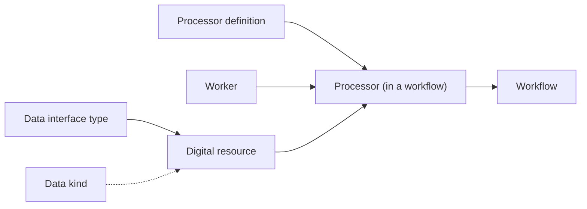

# Warehouse

The Warehouse is your catalogue. Each tab is a searchable, paginated table with a **Search by Name** box, a **Creation Date** filter and **Apply Filters**.

| Tab | Holds | Page |
|---|---|---|
| **Workflows** | Saved workflows and workflow templates | [Workflows](/user-guide/warehouse/workflows/) |
| **Digital Resources** | Concrete data sources and sinks | [Digital resources](/user-guide/warehouse/digital-resources/) |
| **Workers** | Machines that run processor containers | [Workers](/user-guide/warehouse/workers/) |
| **Data Kinds** | Payload descriptions and schemas | [Data kinds](/user-guide/warehouse/data-kinds/) |
| **Processor Definitions** *(Catalog)* | Reusable processing components | [Processor definitions](/user-guide/warehouse/processor-definitions/) |
| **Data Interface Types** *(Admin)* | Templates for kinds of endpoints | [Data interface types](/user-guide/warehouse/data-interface-types/) |

## Row actions

Click a row (or its **open** icon) to open the item's form; for workflows this loads the workflow in the **Workflow Lab**. Other icons in the **Actions** column:

| Icon | Meaning | Where |
|---|---|---|
| Rocket | **Deploy** — run the workflow's deployment DAG | Workflows |
| Stop | **Stop** — run the teardown DAG | Workflows |
| Duplicate | Create an editable copy (for someone else's shared workflow, a copy on your own workers) | All catalogue tabs |
| Share / Make private | Change who can see the item; see [Private and shared items](#private-and-shared-items) | Your own items |
| Export | Download the item and what it depends on as a `.maize.json` file | Workflows, digital resources, definitions, data kinds, interface types |
| Trash | Delete (asks for confirmation; processor definitions in use cannot be deleted) | All tabs |
| Chart | Open in Kibana | Elasticsearch digital resources |
| AKHQ | Open the topic in AKHQ | Kafka digital resources |

Select several rows to delete or **export** them together; a file holds at most one workflow. The **Import** button above each table reads such a file, shows what will be reused, created or renamed, and lets you choose a worker for each processor. An imported workflow opens in the Workflow Lab for review.

Workflow rows also show the status of the five most recent **deployments** and **teardowns** as coloured dots.

## Private and shared items

Everything you create is **private** at first: only you see it. **Share** an item to let every user on the instance see it and use it in their own workflows. The **Sharing** column says *Mine · Private*, *Mine · Shared*, *Shared* (someone else's) or *WME managed* (the built-in starter definitions, shared and read-only). The filter above the table shows **All**, **Mine** or **Shared** items.

- Others can use your shared items but not change them; admins can edit and delete shared items.
- A shared item can only depend on shared items. Sharing a workflow, for example, asks to share its definitions and digital resources too.
- Something other users are using cannot be made private again.
- Someone else's shared workflow opens read-only, without secret values or their workers. **Duplicate** copies it to your workflows on your own workers, with secrets left empty.
- Workers are always private.
- A shared digital resource never shows its secret values to anyone, but processors that use it do receive them when they run.
- When you use someone else's definition from a private GitHub repository, it is installed on your worker with your own GitHub token of the same label (see [Settings](/user-guide/settings/#github-tokens)).

To copy all shared items to another instance, use [Shared Library](/user-guide/settings/#shared-library) in Settings.

## Dependencies between objects

If the Warehouse shows an initialization warning, run [Initialize Resources](/user-guide/settings/#initialize-resources) first: it creates the interface types, data kinds and worker category everything else depends on.
